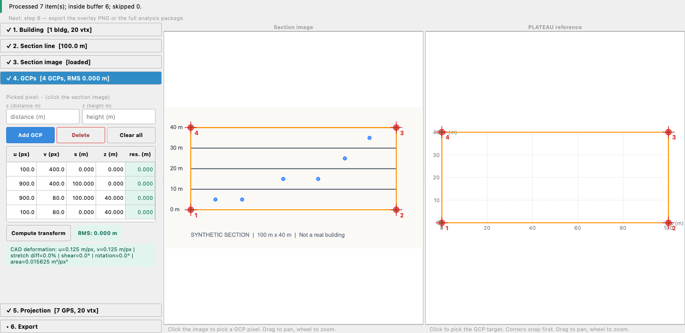

# Section Georeferencer

Section Georeferencer is a research MVP QGIS 3.44+ plugin for georeferencing
architectural section drawing images and overlaying projected 3D geospatial
data on top of the section.

This is not a normal map georeferencer. A normal map georeferencer links image
pixels to map coordinates such as x/y. This plugin links image pixels to local
section coordinates:

- `s`: distance along a user-defined section line
- `z`: height in the section drawing

The plugin then projects world coordinates `(x, y, z)` from GPS, CAD, or
PLATEAU-derived vector layers into `(s, z)` and draws the result over the
section image.



The screenshot and [bundled walkthrough](examples/synthetic/README.md) use
invented data. They demonstrate operation, not accuracy on real observations.

## Installation

For a packaged installation, use `section_georeferencer-0.2.2.zip` from the
release assets when published. In QGIS, open **Plugins > Manage and Install
Plugins > Install from ZIP**, select that file, then enable the plugin. The
ZIP contains a single `section_georeferencer/` folder. GitHub's automatic
source-code ZIP is not the installable release archive.

To build that archive from this checkout, run `python scripts/build_plugin.py`.
It writes the ZIP and its SHA256 checksum to `dist/`, includes the license and
synthetic example, and excludes Git history, caches, tests and development tools.

For a development installation:

The plugin folder must be named `section_georeferencer` inside your QGIS
Python plugin directory. Typical plugin directories are:

- macOS: `~/Library/Application Support/QGIS/QGIS3/profiles/default/python/plugins/`
- Windows: `%APPDATA%\QGIS\QGIS3\profiles\default\python\plugins\`
- Linux: `~/.local/share/QGIS/QGIS3/profiles/default/python/plugins/`

Clone the repository straight into that directory under the plugin's name, for
example on macOS:

```bash
cd ~/Library/Application\ Support/QGIS/QGIS3/profiles/default/python/plugins/
git clone https://github.com/hiro-nyon/qgis-section-georeferencer.git section_georeferencer
```

Alternatively clone it anywhere and symlink it into the plugin directory as
`section_georeferencer`. Restart QGIS, then enable **Section Georeferencer** in
the QGIS Plugin Manager. The plugin adds a toolbar/menu action named **Section
Georeferencer**. QGIS 3.44 or later (QGIS 3.x / Qt5) is required; QGIS 4 is not
supported yet.

## Basic Workflow

The window has the six numbered steps in a sidebar on the left, with only the
step being worked on expanded, and the section image and the PLATEAU reference
side by side at full height on the right. Each step title shows `✓` and a short
summary once it is satisfied, finishing a step opens the next one, and a hint
line under the status bar always names the next action in step order. Routine
messages stay in the window's status line; only warnings also go to the QGIS
message bar.

1. Install and enable the plugin.
2. Load PLATEAU, GPS, or CAD-derived vector layers into QGIS.
3. Open **Plugins > Section Georeferencer**.
4. **1. Building** — choose the PLATEAU/CAD building layer in the list (polygon
   layers of the project), click **Pick on map**, and click the building on the
   QGIS map. Shift-click (or Cmd-click) adds or removes more buildings; Esc or
   right-click finishes. The picked building's footprint is filled orange with a
   red outline on the map (while the plugin window is open) so it stands out
   from any layer style. It is also selected in its layer, so **PLATEAU/CAD** in
   step 5 projects the same building. **Use QGIS selection** takes the features already selected in the
   active layer instead.
5. **2. Section line** — draw the line through the picked building with **Draw
   on map** (two clicks on the QGIS map canvas), **Manual** (the coordinate
   fields), or **From line** (a selected line feature). P0 is the left end
   (`s=0`) and P1 is the right end (`s=section length`) of the section-coordinate
   view. The map keeps these endpoint labels and a P0→P1 arrow visible so the
   orientation can be checked. As soon as the line is set, the building is
   projected onto it and the reference section appears in the right-hand panel
   with s/z axis ticks; redrawing the line or changing the buffer, z offset, or
   height field re-projects it. If the line misses the building, the status line
   says so. While **Pick on map** or **Draw on map** is active the plugin window
   shrinks to its step sidebar at the right edge of the screen so it does not
   cover the map, and returns to its size afterwards.
6. **3. Section image** — load the scanned/paper CAD section drawing
   (PNG, JPEG, TIFF, or PDF). Zoomed out, a downscaled copy of the image is
   drawn so thin drawing lines stay visible.
7. **4. GCPs** — for each GCP, click the CAD image to pick source pixel
   `(u, v)` and click the PLATEAU reference to fill target `(s, z)`; both picks
   are shown with an orange "new" mark until **Add GCP** registers the pair.
   **Add GCP** is enabled only when both are picked, and each pick is used once.
   Registered GCPs are numbered red marks on both panels. The reference view
   snaps to corners (projected vertices and segment endpoints) first and to the
   nearest point on an edge only when no corner is within 12 screen pixels.
   Left-dragging either panel pans it; only a click that does not move picks a
   coordinate. The line under each panel shows the coordinates under the
   pointer.
8. The affine transform is computed automatically as soon as 3 GCPs exist, and
   again after every add or delete. **Compute transform** recomputes on demand.
   Three GCPs always fit exactly, so add a fourth to check the fit. The RMS badge
   and the per-GCP residual column are green up to 0.2 m, amber up to 1 m, and
   red above, and selecting a row rings that GCP on the image.
9. **5. Projection** — project the active GPS point layer or the active
   PLATEAU/CAD vector layer. If features are selected in the active layer, only
   those are projected; otherwise the whole layer is processed. Projecting the
   same layer again **replaces** its previous result rather than appending a
   duplicate copy. Identity is based on QGIS's layer ID, so distinct layers with
   the same display name remain separate, and renaming a layer does not duplicate
   it. A new GCP fit or clearing/deleting GCPs clears projected results; project
   the layers again after calibration changes.
10. **6. Export** — export the overlaid section as PNG, or export a reproducible
   section analysis package. Markers in the exported PNG are scaled to the image
   size so they stay visible at full resolution.
11. Save or load the JSON configuration as needed.

## Paper CAD / PLATEAU / GPS Handoff Model

The intended handoff is:

1. In QGIS, set a projected metric project CRS, for example JGD2011 / Japan
   Plane Rectangular CS IX (EPSG:6677) for Tokyo. EPSG:6697 is geographic and
   is refused (see CRS Assumptions).
2. Load the PLATEAU layer into QGIS with normal QGIS tools.
3. In the plugin, click **Pick on map** and click the relevant PLATEAU building
   on the QGIS map.
4. Define a section line through it in the QGIS XY map canvas by clicking two
   points, or use manual/selected-line input. The map drawing tool shows a
   crosshair marker, previews a dashed line from P0 to the cursor, and follows
   QGIS snapping settings when snapping is enabled. After the second point, a
   persistent P0→P1 arrow and color-coded endpoint labels show that P0 becomes
   the section view's left end and P1 becomes its right end.
5. The picked building is projected onto the line and shown as the PLATEAU
   reference section in the plugin.
6. Load the scanned CAD section drawing as the section background image.
7. Use GCPs to fit the CAD image pixel space to PLATEAU-derived section
   coordinates `(s, z)`: click the CAD image for `(u, v)` and click/snapped-pick
   the PLATEAU reference view for `(s, z)`.
8. Project PLATEAU/CAD and GPS layers.
9. Export **Section Analysis Package**.
10. In any normal Python environment, use the exported background image plus
   `gps_projected.csv`, `plateau_projected.geojson`, and `section_config.json`
   to redraw or statistically validate the overlay.

The external Python side does not need QGIS. It can either plot the exported
`u`/`v` columns directly or use the transform metadata in `section_config.json`
to project new `(x, y, z)` records that are already in the same CRS as the
exported config.

## CRS Assumptions

The QGIS project CRS is used as the section coordinate CRS. Manual section
coordinates are assumed to already be in the project CRS.

When a source layer CRS differs from the project CRS, the plugin transforms
feature x/y coordinates into the project CRS before computing section
coordinates.

The project CRS must be projected. Section distance `s`, perpendicular distance
`d`, and the buffer are planar distances in CRS units while `z` is in metres, so
a geographic CRS would make them degrees. The plugin refuses to define a section
line, load a PLATEAU reference, project, or export while the project CRS is
geographic or its units are not metres. Source layers must also have a valid
CRS; an unknown CRS or failure to construct its coordinate transform stops that
projection and keeps any previous result. Assign the correct source CRS first;
merely assigning the project CRS to geographic coordinates is not a conversion.

PLATEAU data is distributed in EPSG:6697 (JGD2011 geographic + JGD2011 height),
which is geographic. Keep the layers in EPSG:6697 if you like, but set the
project CRS to the matching JGD2011 / Japan Plane Rectangular CS zone
(EPSG:6669-6687, for example EPSG:6677 for zone IX, Tokyo). Layer x/y are
transformed into the project CRS; heights are used as stored.

The section line is tied to the project CRS it was defined in. If the project
CRS changes afterwards, projection and export are blocked until the CRS is
switched back or the line is redefined. A config whose `crs` differs from the
project CRS loads with a warning and is blocked the same way. A config saved in
a geographic CRS (for example EPSG:6697 with earlier versions) loads its image
and settings only: its section line and GCP targets are in degrees, so the line
has to be redefined and the GCPs picked again.

The exported `gps_projected.csv` stores `x`/`y` after transformation
into the QGIS project CRS, and also stores ready-to-plot section-image pixel
coordinates `u`/`v`. External Python validation normally uses `u`/`v` directly
to draw on `section_background.png`; it does not need QGIS or PyQGIS.

## Height Handling

Vertical CRS and height datum alignment are intentionally simple in this MVP:

```text
z_section = z - z_offset
```

Set `z_offset` in the dock if the source data height datum needs to be shifted
to match the section drawing. The user is responsible for height datum
alignment.

For z extraction of point layers (GPS), a height field typed in **Height
field** wins over geometry Z, because naming one means the geometry Z is not the
wanted height (GPS points stored as PointZ with z=0 are common). For line and
polygon layers (PLATEAU/CAD), geometry Z always wins and the named field only
fills in geometry without Z; otherwise a per-building value such as
`measuredHeight` would flatten a 3D building to one height. Features where the
field is empty, and layers that do not have it, fall back to geometry Z; a
missing field is reported as a warning. After those, common fields such as `z`,
`height`, `altitude`, `elevation`, `measuredHeight`, and `bldg_measuredHeight`
are tried.
The `z_source` column records which one was used for each record.

The section line, z offset, buffer, and height field are fixed once results
depend on them. Changing the section line asks before clearing the PLATEAU
reference, GCPs, transform, and projected overlay. Changing the z offset asks
before clearing the reference, the GCPs and transform (their heights move with
the offset), and the overlay; changing the buffer or height field asks before
clearing the reference and the overlay. Declining keeps the previous value, so
an exported config always describes the settings its rows were made with.

## Config JSON

The plugin can save and load a JSON config containing:

- plugin/version metadata
- project CRS authid
- section line and length
- image path
- z offset
- buffer width
- z field
- GCPs
- affine transform coefficients and RMS residual
- CAD deformation metrics: horizontal/vertical scale, principal stretch
  difference, shear, rotation, area scale, warning thresholds, and warnings

The GCP manager displays these deformation metrics after fitting. A warning is
shown when the maximum-to-minimum directional stretch differs by more than 20%
or when affine shear moves the image axes more than 5 degrees away from a right
angle. Rotation and uniform scaling are reported but do not trigger warnings.

Config structure, finite numeric values and mutually inverse affine coefficients
are checked before replacing the current session. Invalid configs leave the
session intact. Loading a config without an image clears the previous canvas.
**Clear image** clears its GCPs, transform and projected results too; they cannot
be reused on a different image.

Image paths are stored relative to the config file when possible. Missing image
paths produce a warning while preserving the rest of the loaded configuration.

## Section Analysis Package Export

Use **Export Section Analysis Package** to create a named package folder that
can be validated outside QGIS. Files inside the folder use the package name as
a prefix, and the exact file names are recorded in `package_files` in the
exported config, so consumers should read that mapping instead of hardcoding
names. With the default legacy names, the package contains:

- `section_background.png`: the original section image without GPS overlay
- `section_background_georeferenced.tif`: GeoTIFF version of the section
  background, georeferenced in section coordinates
- `section_preview.png`: section image with current projected overlays
- `section_config.json`: CRS, section line, buffer, z offset, image size, GCPs,
  affine transforms, RMS residual, source layer names, and export timestamp
- `gps_projected.csv`: every processed GPS point with section coordinates,
  pixel coordinates, raw z, z source, layer name, `inside_buffer`, and every
  attribute of the source layer (an attribute named like a computed column,
  such as `x` or `s`, is written as `src_x`, `src_s`; prefixes are repeated if
  needed to avoid existing names). `projection_summary.json` records each source
  layer's attribute-name mapping. `source_layer_id` distinguishes same-named
  layers within the QGIS session/project. Empty attributes are
  empty cells. Dates and times are ISO 8601 and keep exactly the time-zone
  information they had in QGIS: a naive observation time such as TRIMA
  `recordedat` (JST) stays naive and is not shifted
- `plateau_projected.geojson`: projected PLATEAU/CAD vertices and simple
  segments in section coordinates `(s, z_section)`, with pixel `u`/`v` kept as
  feature properties
- `world_projected.geojson`: the same GPS and PLATEAU records in project-CRS
  world coordinates `[x, y, z_raw]`, for loading straight into QGIS or geopandas.
  The project CRS is declared in the GeoJSON `crs` member (for example
  `urn:ogc:def:crs:EPSG::6677`), which GDAL, QGIS, and geopandas honour; plain
  RFC 7946 readers that ignore it would assume WGS84
- `section_projected.gpkg`: GeoPackage with `gps`, `plateau`, and
  `plateau_segments` layers in world coordinates (written only when the GDAL
  Python bindings are available)
- `projection_summary.json`: per-source-layer processing counts and warnings
- `gcp_residuals.csv`: written when transform residuals are available

`section_config.json` inside the package is not byte-identical to a config saved
with **Save config**: its `image.path` points at the packaged background image
and the original file name is kept in `image.source_name`, so the package stays
self-contained and carries no absolute path from the exporting machine.

The GeoTIFF declares a **local engineering CRS in metres**, not the map CRS.
`SECTION_SOURCE_CRS` stores the original project CRS as supplementary metadata.
Its fitted affine transform is a raster GeoTransform:

```text
GeoTIFF X = s_along_section
GeoTIFF Y = z_section
```

This is useful for external Python/GDAL workflows that want a georeferenced
section raster. It is not a normal plan-view map raster. Its grid axes are section axes `(s, z_section)`, not longitude/latitude or map x/y. Use
`section_config.json` for the section line `p0/p1`, height offset, and affine
metadata needed to reconstruct the relationship to the original 3D project
coordinates.

GPS CSV export intentionally includes points outside the section buffer with
`inside_buffer=false`. This allows vertical stratification to be checked
reproducibly in an external Python environment instead of relying only on a PNG.

For PLATEAU/CAD, select the target building feature in QGIS before clicking the
projection button if the section should use one building only. Multiple selected
features are also supported.

## External Python Validation

An example QGIS-free validation script is included:

```bash
python examples/validate_section_package.py /path/to/exported_package
```

It uses `pandas`, `numpy`, `matplotlib`, `pillow`, and `json` to load the
package, replot GPS points and PLATEAU/CAD projected vertices/segments over the
section background, plot a `z_section` histogram, and export:

- `validation_overlay.png`
- `validation_z_histogram.png`
- `validation_floor_counts.csv`

If `floor_reference.csv` exists in the package folder, the script assigns each
GPS point to the nearest floor center. If scikit-learn is installed, it also
writes optional Gaussian mixture z-cluster centers.

## Limitations

- Only affine pixel-to-section transforms are implemented.
- PDF loading depends on the GDAL PDF driver (Poppler or PDFium) shipped with
  QGIS. The first page is rendered at up to 600 DPI; large sheets are rendered
  at a reduced DPI so the raster stays under roughly 120 megapixels.
- Strict 3D mesh-plane intersection is not implemented.
- Vector projection uses vertices within the section buffer.
- 2D polygon layers with a height attribute are drawn as a simple top-outline
  approximation.
- Height datum alignment must be handled by the user through `z_offset`.
- Buffer width assumes a metric projected CRS.
- Styling is intentionally simple for MVP output figures.
- PLATEAU/CAD package export stores projected vertices and simple segment
  features; it does not export exact mesh-section intersection curves. A
  segment joins two consecutive vertices of the same ring only, never the end
  of one part, face, or ring to the start of the next.

## Future Work

- Multi-page PDF selection
- TPS or polynomial transforms
- Strict 3D mesh section intersection
- SVG/PDF export
- BEMS/CAD zone support
- Integration with the QGIS elevation profile panel

## Tests

`transforms.py`, `config_io.py`, and `package_exporter.py` do not import QGIS,
so they run under a plain Python 3 interpreter. From the repository root:

```bash
python -m unittest discover -s tests
```

`section_georeferencer_dock.py`, `section_canvas.py`, and `layer_projector.py`
import PyQGIS and Qt. Their tests (`test_layer_projector.py`,
`test_dock_state.py`) are skipped under plain Python and run headless with the
Python that ships with QGIS, for example on macOS:

```bash
PYTHONHOME=/Applications/QGIS.app/Contents/Frameworks QT_QPA_PLATFORM=offscreen /Applications/QGIS.app/Contents/MacOS/python3.12 -m unittest discover -s tests
```

## Tested environments and release checks

- Minimum declared version: QGIS 3.44 (raised from 3.28 in 0.2.2 to match the
  verified baseline). QGIS 4 / Qt6 is not supported.
- Locally verified: macOS, QGIS 3.44.5, Python 3.12, all PyQGIS and GDAL tests.
- CI configuration: official QGIS 3.44 / Ubuntu Noble container, pinned by
  digest. `scripts/run_qgis_tests.py` fails if **any** test is skipped, then CI
  builds and smoke-tests the actual ZIP. A configured job is not a completed
  Linux test run; check its Actions result after pushing.
- Windows interactive behavior and native Linux desktop behavior are not yet
  verified. The plugin remains experimental; no cross-platform certification
  is implied.

Run `scripts/smoke_test_zip.py` with QGIS's Python after building the ZIP. It
extracts to a temporary plugin directory and isolated profile, uses QGIS's
plugin loader, loads the bundled project/config, projects seven synthetic GPS
points (six inside the buffer), exports CSV/GeoTIFF/GeoPackage, reloads the
package config, and unloads the plugin. It does not use the installed checkout.
This is an automated integration check, not a manual click-through test.

Before publishing a release, run both QGIS scripts above, build the ZIP, check
`git diff --check`, commit the source **including LICENSE**, and tag that exact
commit `v0.2.2`. Attach the ZIP and checksum to the GitHub Release. Keep `dist/`
out of source control. See [CHANGELOG.md](CHANGELOG.md) for release notes.

## License

Section Georeferencer is free software: you can redistribute it and/or modify
it under the terms of the GNU General Public License as published by the Free
Software Foundation, either version 2 of the License, or (at your option) any
later version (GPL-2.0-or-later). See [LICENSE](LICENSE).

Issues and feature requests:
<https://github.com/hiro-nyon/qgis-section-georeferencer/issues>

## Status

Research MVP, marked `experimental=True` in `metadata.txt`. Interfaces and the
package format may still change.
